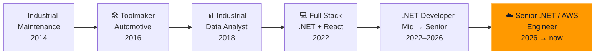
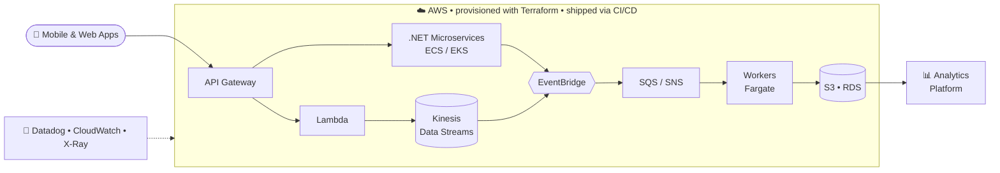

<!-- ═══════════════════════════ HEADER ═══════════════════════════ -->
<p align="center">
  
</p>

<p align="center">
  <a href="https://github.com/Guilherme-Benfica">
    
  </a>
</p>

<p align="center">
  <a href="https://www.linkedin.com/in/guilherme-benfica/"></a>
  <a href="https://www.credly.com/users/guilherme-benfica/badges"></a>
  
</p>

---

### `> whoami`

```csharp
public sealed record Engineer
{
    public string   Name     => "Guilherme Benfica";
    public string   Location => "Jundiaí, SP — Brazil 🇧🇷";
    public string   Now      => "Senior .NET / AWS Software Engineer @ CI&T";
    public string[] Roles    => ["Senior Software Engineer", "Software Architect", "Cloud Infrastructure"];
    public string[] Clouds   => ["AWS", "Azure", "GCP", "OCI"];
    public string[] Domains  => ["Banking", "Investments", "Financial Services", "Government", "E-commerce"];
    public string[] Building => ["Event-driven platforms", "Real-time data pipelines", "Cloud-native APIs", "AI agents (RAG + MCP)"];

    public bool AwsGoldenJacket => true; // every active AWS certification 🧥
}
```

---

### 🏅 Highlights

<table>
  <tr>
    <td align="center" width="25%">
      <h2>🧥</h2>
      <b>AWS Golden Jacket</b><br/>
      <sub>All active AWS certifications</sub>
    </td>
    <td align="center" width="25%">
      <h2>38</h2>
      <b>Certifications</b><br/>
      <sub>AWS • Microsoft • Google • GitHub • Oracle</sub>
    </td>
    <td align="center" width="25%">
      <h2>🏗️</h2>
      <b>Azure Solutions Architect Expert</b><br/>
      <sub>AZ-305</sub>
    </td>
    <td align="center" width="25%">
      <h2>🎓</h2>
      <b>Instructor</b><br/>
      <sub>AWS practice exams on Udemy</sub>
    </td>
  </tr>
</table>

---

### 🔄 From the factory floor to the cloud



> I started fixing hydraulic presses and building automotive tooling. That background taught me how real systems fail — and today I apply the same mindset to **software architecture and cloud infrastructure** on AWS and Azure.

---

### 🧭 What I do

<table>
  <tr>
    <td width="50%" valign="top">
      <b>🏗️ Software Architecture</b><br/>
      Microservices, DDD, CQRS and event-driven architecture. Technical reference for teams: architecture decisions, code reviews, standards and legacy modernization.
    </td>
    <td width="50%" valign="top">
      <b>☁️ Cloud Infrastructure</b><br/>
      Cloud-native platforms on AWS and Azure, provisioned with <b>Terraform</b> and <b>CloudFormation</b>, delivered through CI/CD with GitHub Actions, CodePipeline and Azure DevOps.
    </td>
  </tr>
  <tr>
    <td width="50%" valign="top">
      <b>⚡ Real-time & Event Processing</b><br/>
      Streaming and event pipelines with Kinesis, EventBridge, Kafka, SQS/SNS and RabbitMQ — integrating mobile apps and analytics platforms at scale.
    </td>
    <td width="50%" valign="top">
      <b>🤖 Generative AI Engineering</b><br/>
      LLMs, RAG, MCP and AI agents applied to day-to-day engineering, plus AI-assisted development with GitHub Copilot and Claude.
    </td>
  </tr>
  <tr>
    <td width="50%" valign="top">
      <b>🔭 Observability</b><br/>
      Monitoring and tracing with Datadog, CloudWatch, X-Ray, Grafana, Splunk, Dynatrace and AppDynamics.
    </td>
    <td width="50%" valign="top">
      <b>🔐 Cloud Security</b><br/>
      IAM and access management, hardening, OWASP, secure architecture, SonarQube and Fortify in DevSecOps pipelines.
    </td>
  </tr>
</table>

---

### 🛠️ Tech Stack

| | |
|:--|:--|
| **Cloud** |   |
| **Infra & DevOps** |  |
| **Backend** |  |
| **Frontend** |  |
| **Databases** |    |

<details>
<summary><b>☁️ AWS services I work with</b></summary>
<br/>


</details>

<details>
<summary><b>🧱 Engineering practices</b></summary>
<br/>


-512BD4?style=flat-square)


</details>

---

### 🧩 How I build systems



---

### 🏆 Certifications

<p align="center">
  
  
  
  
  
</p>

<p align="center">
  <a href="https://www.credly.com/users/guilherme-benfica/badges"><b>🔗 See all verified badges on Credly</b></a>
</p>

### 🎓 Education

| | |
|:--|:--|
| ☁️ | **Postgraduate** — Software Architecture & Cloud Computing |
| 💻 | **B.Sc.** — Computer Engineering |
| ⚙️ | **Degree** — Industrial Automation |

---

### 🚀 Featured Projects

<p align="center">
  <a href="https://github.com/Guilherme-Benfica/PJI110-A2026S1N1-Grupo15-Caixa_Facil">
    
  </a>
  <a href="https://github.com/Guilherme-Benfica/SystemWeb-ASP-.NET-Core-MVC">
    
  </a>
</p>

---

### 📊 GitHub Analytics

<p align="center">
  
  
</p>

<p align="center">
  
</p>

---

<p align="center">
  <i>"There's no such thing as a wasted certification — each one builds muscle for the next."</i>
</p>

<!-- ═══════════════════════════ FOOTER ═══════════════════════════ -->
<p align="center">
  
</p>
